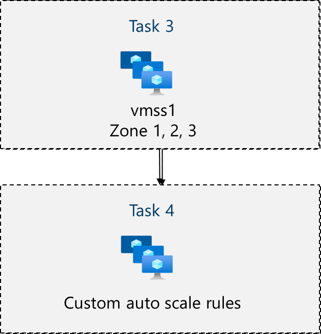
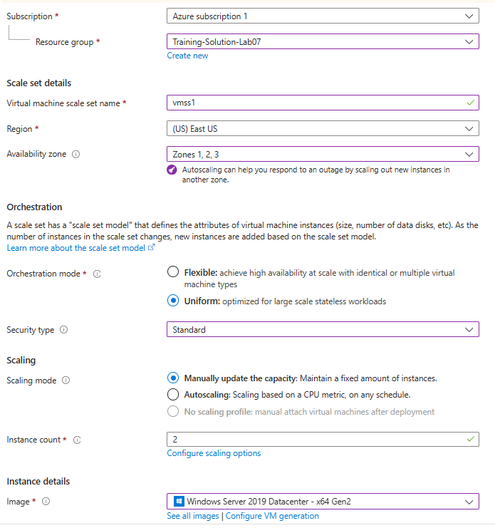
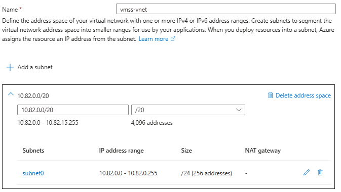
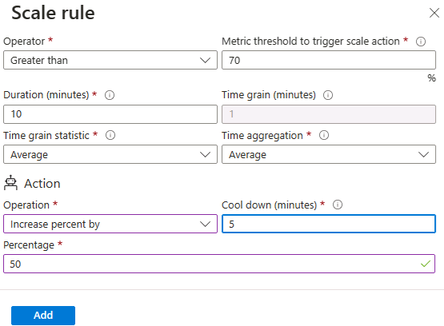

# Lab 07 - Manage Virtual Machines Scale Sets

## Lab introduction

In this lab, you learn how to create a virtual machine scale set and configure autoscaling.

This lab requires an Azure subscription. Your subscription type may affect the availability of features in this lab. You may change the region, but the steps are written using **East US**.

## Estimated timing: 75 minutes

## Lab scenario

Your organization wants to explore automatic scaling. You implement a Virtual Machine Scale Set and explore autoscaling.

## Job skills

+ Task 1: Create and configure Azure Virtual Machine Scale Sets.
+ Task 2: Scale Azure Virtual Machine Scale Sets.
+ Task 3: Connect to the instances with Azure Bastion.
+ Task 4: Trigger the scale set to scale out.
+ Task 5: Trigger the scale set to scale in.
+ Task 6: Visualize CPU metrics in Azure Monitor.
+ Task 7: Clean up.

## Permissions needed

| Who | Role | Scope | Why |
| --- | --- | --- | --- |
| You (student account) | **Owner** (already assigned) | `rg-studentNN-lab07` | Create the scale set, load balancer, network, autoscale settings and Azure Bastion, and connect to the instances. Contributor or Network Contributor plus Virtual Machine Contributor is the minimum. |

> **Note**: Everything in this lab is created in your own resource group, so no administrator setup is needed. Azure Bastion is billed by the hour, so complete **Task 7** at the end of the lab.


## Instructions

### Before you start

#### Sign in to the lab environment

Sign in to your Windows 11 virtual machine (VM).

> **Note**: Your instructor will provide instructions to connect to the virtual lab environment.


## Azure Virtual Machine Scale Sets Architecture Diagram



## Task 1: Create and configure Azure Virtual Machine Scale Sets

In this task, you will deploy an Azure virtual machine scale set across availability zones. VM Scale Sets reduce the administrative overhead of automation by enabling you to configure metrics or conditions that allow the scale set to horizontally scale, scale in or scale out.

1. In the Azure portal, search for and select `Virtual machine scale sets` and, on the **Virtual machine scale sets** blade, click **+ Create**.

1. On the **Basics** tab of the **Create a virtual machine scale set** blade, specify the following settings (leave others with their default values) and click **Next : Spot >**:

    | Setting | Value |
    | --- | --- |
    | Subscription | the name of your Azure subscription  |
    | Resource group | **rg-studentNN-lab07** |
    | Virtual machine scale set name | `vmss1` |
    | Region | **(US)East US** |
    | Availability zone | **Zones 1, 2** |
    | Orchestration mode | **Uniform** |
    | Security type | **Standard** |
    | Scaling options | **Review and take the defaults**. We will change this in the next task. |
    | Image | **Windows Server 2019 Datacenter - x64 Gen2** |
    | Size | click on the link "See all sizes", then select **Standard_B2s_v2** |
    | Username | `localadmin` |
    | Password | **Provide a secure password**  |
    | Already have a Windows Server license? | **Unchecked** |

    > **Notes:** For the list of Azure regions which support deployment of Windows virtual machines to availability zones, refer to [What are Availability Zones in Azure?](https://docs.microsoft.com/en-us/azure/availability-zones/az-overview)

    > **Notes:** The older **Standard B1s** size is no longer offered in East US, and **Standard_B2s_v2** may not be available in zone 3 for your subscription. If the portal shows a size or zone as unavailable, pick zones that the size supports. To check from Cloud Shell, run `az vm list-skus -l eastus --size Standard_B2s_v2 -o table` and look at the **Restrictions** column.

    

1. On the **Spot** tab, accept the defaults and select **Next : Disks >**.

1. On the **Disks** tab, accept the default values and click **Next : Networking >**.

1. On the **Networking** page, select **Edit virtual network** link. Make the following changes. When finished, select **Save**.

    | Setting | Value |
    | --- | --- |
    | Name | `vmss-vnet` |
    | Address range | `10.82.0.0/20` (delete the existing address range, and click on **Add IPv4 address space**) |
    | Subnet name | `subnet0` (click on **+ Add a subnet**, then **Add**)|

    
   
1. In the **Networking** tab, click the **Edit network interface** pen icon to the right of the network interface entry.

1. For **NIC network security group** section, select **Advanced** and then click **Create new** under the **Configure network security group** drop-down list.

1. On the **Create network security group** blade, specify the following settings (leave others with their default values):

    | Setting | Value |
    | --- | --- |
    | Name | **vmss1-nsg** |

1. Click **Add an inbound rule** and add an inbound security rule with the following settings (leave others with their default values):

    | Setting | Value |
    | --- | --- |
    | Source | **Any** |
    | Source port ranges | * |
    | Destination | **Any** |
    | Service | **HTTP** |
    | Action | **Allow** |
    | Priority | **1010** |
    | Name | `allow-http` |

1. Click **Add** and, back on the **Create network security group** blade, click **OK**.

1. In the **Edit network interface** blade, in the **Public IP address** section, leave it **Disabled** and click **OK**.

    > **Notes:** The instances do not need their own public IP addresses. Web traffic reaches them through the load balancer, and you sign in through Azure Bastion in Task 3. This keeps the instances off the internet and saves public IP quota.

1. In the **Networking** tab, under the **Load balancing** section, specify the following (leave others with their default values).

    | Setting | Value |
    | --- | --- |
    | Load balancing options | **Azure load balancer** |
    | Select a load balancer | **Create a load balancer** |

1. On the **Create a load balancer** page, specify the load balancer name and take the defaults. Click **Create** when you are done then **Next : Management >**.

    | Setting | Value |
    | --- | --- |
    | Load balancer name | `vmss-lb` |

    > **Notes:** Pause for a minute and review what you done. At this point, you have configured the virtual machine scale set with disks and networking. In the network configuration you have created a network security group and allowed HTTP. You have also created a load balancer with a public IP address.

1. On the **Management** tab, specify the following settings (leave others with their default values):

    | Setting | Value |
    | --- | --- |
    | Boot diagnostics | **Disable** |

1. Click **Next : Health >**.

1. On the **Health** tab, review the default settings without making any changes and click **Next : Advanced >**.

1. On the **Advanced** tab, click **Review + create**.

1. On the **Review + create** tab, ensure that the validation passed and click **Create**.

    > **Notes:** Wait for the virtual machine scale set deployment to complete. This should take approximately 5 minutes. While you wait review the [documentation](https://learn.microsoft.com/azure/virtual-machine-scale-sets/overview).

---

## Task 2: Scale Azure Virtual Machine Scale Sets

In this task, you scale the virtual machine scale set using a custom scale rule.

1. Select **Go to resource** or search for and select the **vmss1** scale set.

1. Choose **Availability + Scale** from the left side menu, then choose **Scaling**.

    > **Did you know?** You can **Manual scale** or **Custom autoscale**. In scale sets with a small number of VM instances, increasing or decreasing the instance count (Manual scale) may be best. In scale sets with a large number of VM instances, scaling based on metrics (Custom autoscale) may be more appropriate.

**Scale out rule**

1. Select **Custom autoscale**. Then change the **Scale mode** to **Scale based on metric**. And then select **Add a rule**.

1. Let's create a rule that automatically increases the number of VM instances. This rule scales out when the average CPU load is greater than 70% over a 10-minute period. When the rule triggers, the number of VM instances is increased by 50%.

    | Setting | Value |
    | --- | --- |
    | Metric source | **Current resource (vmss1)** |
    | Metric namespace | **Virtual Machine Host** |
    | Metric name | **Percentage CPU** (review your other choices) |
    | Operator | **Greater than** |
    | Metric threshold to trigger scale action | **70** |
    | Duration (minutes) | **10** |
    | Time grain statistic | **Average** |
    | Operation | **Increase percent by** (review other choices) |
    | Cool down (minutes) | **5** |
    | Percentage | **50** |

    

1. Be sure to **Save** your changes.

**Scale in rule**

1. During evenings or weekends, demand may decrease so it is important to create a scale in rule.

1. Let's create a rule that decreases the number of VM instances in a scale set. The number of instances should decrease when the average CPU load drops below 30% over a 10-minute period. When the rule triggers, the number of VM instances is decreased by 50%.

1. Select **Add a rule**, adjust the settings, then select **Add**.

    | Setting | Value |
    | --- | --- |
    | Operator | **Less than** |
    | Threshold | **30** |
    | Operation | **decrease percentage by** (review your other choices) |
    | Percentage | **50** |

1. Be sure to **Save** your changes.

**Set the instance limits**

1. When your autoscale rules are applied, instance limits make sure that you do not scale out beyond the maximum number of instances or scale in beyond the minimum number of instances.

1. **Instance limits** are shown on the **Scaling** page after the rules.

    | Setting | Value |
    | --- | --- |
    | Minimum | **2** |
    | Maximum | **4** |
    | Default | **2** |

    > **Notes:** A maximum of 4 is enough to see scale-out and keeps the class within the subscription's vCPU quota. In production, set the maximum from your expected peak load and your quota.

1. Be sure to **Save** your changes

1. On the **vmss1** page, select **Instances**. This is where you would monitor the number of virtual machine instances.

---

## Task 3: Connect to the instances with Azure Bastion

In this task, you deploy Azure Bastion into the scale set's virtual network so you can sign in to the instances from the browser. The instances have no public IP addresses, so Bastion gives you RDP access without exposing them to the internet or opening port 3389.

Azure Bastion needs:

+ A subnet named exactly `AzureBastionSubnet`, size /26 or larger, in the same virtual network as the instances (`vmss-vnet`).
+ A Standard SKU public IP address. The portal creates it for you.
+ The **Basic** tier or higher. The free **Developer** tier is not documented to support scale set instances, so this lab uses Basic.

1. In the Azure portal, search for and select `Virtual networks`, then select **vmss-vnet**.

1. Select **Settings > Subnets**, then select **+ Subnet**. Specify the following settings and select **Add**.

    | Setting | Value |
    | --- | --- |
    | Subnet purpose | **Azure Bastion** |
    | Name | `AzureBastionSubnet` (filled in for you) |
    | Starting address | `10.82.1.0` |
    | Size | **/26** |

1. Search for and select `Bastions`, then select **+ Create**. Specify the following settings (leave others with their default values) and select **Review + create**, then **Create**.

    | Setting | Value |
    | --- | --- |
    | Resource group | **rg-studentNN-lab07** |
    | Name | `vmss-vnet-bastion` |
    | Region | **(US) East US** |
    | Tier | **Basic** |
    | Virtual network | **vmss-vnet** |
    | Subnet | **AzureBastionSubnet** |
    | Public IP address | **Create new**, name `vmss-vnet-bastion-ip` |

    > **Notes:** The deployment takes about 5 to 10 minutes. Azure Bastion is billed by the hour while it exists, so delete it in **Task 7**.

    > **Notes:** If you prefer Cloud Shell (Bash), these commands create the same resources:

    ```bash
    az network vnet subnet create --resource-group rg-studentNN-lab07 --vnet-name vmss-vnet --name AzureBastionSubnet --address-prefixes 10.82.1.0/26
    az network public-ip create --resource-group rg-studentNN-lab07 --name vmss-vnet-bastion-ip --location eastus --sku Standard --allocation-method Static
    az network bastion create --resource-group rg-studentNN-lab07 --name vmss-vnet-bastion --location eastus --vnet-name vmss-vnet --public-ip-address vmss-vnet-bastion-ip --sku Basic
    ```

1. When the deployment completes, go to **Virtual machine scale sets > vmss1 > Instances** and select the first instance (for example `vmss1_0`).

1. Select **Connect > Bastion**. Change **Authentication Type** from **Microsoft Entra ID** to **VM Password**, then sign in with:
   - **Username**: `localadmin`
   - **VM Password**: the one you set during VMSS creation

    > **Notes:** **Microsoft Entra ID** is the default, but it needs a login extension and an extra role on the instance, which this lab does not set up.

    > **Notes:** If your browser blocks the pop-up window, allow pop-ups for the Azure portal and try again.

1. Repeat the previous two steps for the second instance, in a new browser tab. You need a session on **every** instance for the next task.

---

## Task 4: Trigger the scale set to scale out

The scale-out rule uses the **average** CPU of all instances in the scale set. If you only load one of two instances, the average stays around 50% and never crosses the 70% threshold. Run the stress script on every instance.

### Step 1: Run the CPU stress script on each instance

1. In each Bastion session, right-click **Start** and select **Windows PowerShell (Admin)**.
2. Run the following to simulate 100% CPU usage:

   ```powershell
   for ($i=0; $i -lt $env:NUMBER_OF_PROCESSORS; $i++) {
     Start-Job -ScriptBlock { (Get-Process -Id $PID).PriorityClass = 'BelowNormal'; while ($true) {} }
   }
   ```

    > **Notes:**  This script launches one infinite loop per CPU core in the background to max out CPU usage. The loops run at below-normal priority, so the desktop and PowerShell window stay responsive while the CPU is at 100%. Leave the PowerShell window open. The jobs stop if you close it.

    > **Notes:** Typing through Bastion can occasionally repeat a character. If PowerShell reports a parser error, check the line for doubled characters (for example `$i+++`) and run it again. You can also paste with the clipboard button on the Bastion toolbar.

3. Open **Task Manager** and confirm the CPU is near 100%. It can take a minute or two to get there.

### Step 2: Wait and observe autoscaling
- Wait **10–15 minutes** to allow the autoscale rule to trigger.
- Navigate to:
  - **VMSS > Scaling > Run history** – to view autoscale event logs.
  - **VMSS > Instances** – to watch for new VM instances being added.

    > **Notes:** The scale out rule should trigger when CPU > 70% for 10 minutes. With 2 instances, a 50% increase adds 1 instance. You may see a second scale-out about 5 minutes later, after the cool-down, because the 10-minute average still includes the time before the new instance joined, and a new Windows instance is busy while it starts. The scale set never goes above the maximum of 4. Instance names are not always sequential. For example, the new instance may be `vmss1_3` rather than `vmss1_2`.

---

## Task 5: Trigger the scale set to scale in

### Step 1: Stop the CPU load
1. In each Bastion session, run:

   ```powershell
   Get-Job | Stop-Job
   ```
This will terminate the infinite loops and reduce CPU usage.

### Step 2: Wait and observe scaling in
1. Wait **10–15 minutes** for the average CPU to drop below 30%.
1. Monitor:
   - **VMSS > Scaling > Run history**
   - **VMSS > Instances** – to observe VM instances being removed.

    > **Notes:** VMSS will scale back in according to the configured scale-in rule, but never below the minimum of 2 instances. Your Bastion session closes if the instance you are connected to is removed.

---

## Task 6: Visualize CPU metrics in Azure Monitor

### Step 1: View real-time metrics
1. Go to **Monitor > Metrics** in the Azure portal.
2. Set **Scope** to your `vmss1` resource.
3. Select:
   - **Metric Namespace**: `Virtual Machine Host`
   - **Metric**: `Percentage CPU`
4. Set **Aggregation** to `Average`.
5. Select **Apply splitting** and split by **VMName** to see each instance, and optionally change granularity to **1 minute**.

---

## Task 7: Clean up

Azure Bastion, the scale set instances, the load balancer and the public IP addresses are billed while they exist. Delete them when you are done. Do not delete the resource group itself.

1. Search for and select `Bastions`, select **vmss-vnet-bastion**, then select **Delete**.
1. Search for and select `Virtual machine scale sets`, select **vmss1**, then select **Delete**.
1. When both deletions finish, search for and select `Load balancers`, select **vmss-lb**, then select **Delete**.
1. Search for and select `Public IP addresses`, filter to **rg-studentNN-lab07**, then delete the remaining public IP addresses (the load balancer's and **vmss-vnet-bastion-ip**).

    > **Notes:** The virtual network, network security group and autoscale setting are free, so you can leave them. In Cloud Shell (Bash), these commands do the same clean-up, in order:

    ```bash
    az network bastion delete --resource-group rg-studentNN-lab07 --name vmss-vnet-bastion --yes
    az vmss delete --resource-group rg-studentNN-lab07 --name vmss1
    az network lb delete --resource-group rg-studentNN-lab07 --name vmss-lb
    az network public-ip delete --ids $(az network public-ip list --resource-group rg-studentNN-lab07 --query "[].id" -o tsv)
    ```

## Key takeaways

Congratulations on completing the lab. Here are the main takeaways for this lab.

+ Azure Virtual Machine Scale Sets (VMSS) let you deploy and manage a group of identically-configured VMs that can automatically scale to match demand.  
+ Deploying a VMSS across multiple availability zones increases fault tolerance and availability.  
+ Networking and security must be defined during deployment. Including virtual network, subnet, network security group, public load balancer and public IP address.  
+ Custom autoscale rules enable precise control over when the scale set scales out or in, based on metrics such as average CPU utilization.  
+ Instance limits (minimum, maximum and default counts) protect against over- or under-provisioning when autoscale rules run.  
+ Azure Monitor provides real-time metrics and run-history logs so you can verify and troubleshoot autoscale events.  
+ Generating workload (for example, stressing CPU inside a VM) is an effective way to test that your scale-out and scale-in rules behave as expected. Because the rules use the average across all instances, the load has to reach every instance.  
+ Azure Bastion gives browser-based RDP to private instances without opening RDP ports to the internet. It needs its own `AzureBastionSubnet` and is billed by the hour, so delete it when you are done.  
+ VMSS reduces operational overhead by automatically distributing traffic through the load balancer and maintaining consistent configuration across all instances.
